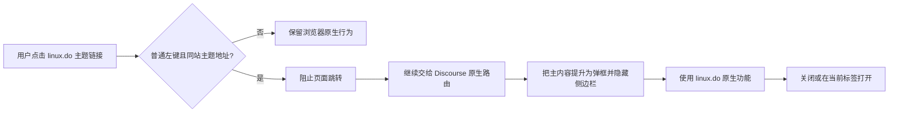

# 帖子弹框阅读脚本使用说明

## 脚本状态

已实现。脚本文件为 [`linux.do 帖子弹框阅读.user.js`](<../userscripts/topic-reader/linux.do 帖子弹框阅读.user.js>)，可以与 Obsidian 保存脚本同时安装。两者独立运行。已发布的历史版本归档在 [`versions/topic-reader/`](../versions/README.md)。

## 目标

用户在 linux.do 的列表、搜索结果、分类页或正文中的主题链接上进行普通点击时，在当前页面以弹框查看主题详情，减少页面跳转和返回列表的操作。

## 安装与使用

在 Tampermonkey 或 Userscripts 中新建脚本，粘贴仓库中的脚本全文并启用。打开 linux.do 的首页、分类、搜索或其他包含主题链接的页面，普通左键点击主题链接即可弹出阅读窗口。

脚本复用当前页面已经启动的 linux.do 单页应用：帖子仍由原生路由打开，脚本把原生主内容节点临时移入居中的透明弹框，并隐藏站点侧边栏。因此点赞、回复、回应、用户卡、图片预览、楼层导航、通知设置和站内链接等操作与直接打开帖子一致。弹框按照 [UI 设计稿](<帖子弹框阅读 UI 设计稿.md>) 实现，仅显示当前标题、展开和关闭操作；点击弹框外区域、关闭按钮或按 Esc 均返回来源列表。

## 用户流程

## 功能范围

### 弹框内容

- 原生主题标题、分类、标签、主帖、回复和楼层时间线。
- 原生点赞、回复、回应、用户卡、图片预览、链接复制、通知级别等交互。
- linux.do 自己负责后续楼层加载、帖子状态和登录权限。
- 弹框工具栏负责返回来源列表、切换为普通页面和关闭。
- 点击遮罩、关闭按钮或按 Esc 关闭弹框。

### 保留的原生行为

- Ctrl、Command、Shift 或 Alt 组合点击不拦截。
- 鼠标中键、带 `target` 的链接、下载链接和外站链接不拦截。
- 直接在地址栏访问主题 URL 时保留 linux.do 原生主题页。
- 弹框内“在原页面打开”使用原始主题链接，不隐藏原生阅读方式。

### 明确不做

- 不自行实现或代理点赞、回复等站内接口；这些操作由原生帖子页完成。
- 不保存阅读历史、离线缓存或同步用户数据。
- 不读取 Obsidian 配置，不调用 Local REST API，也不与保存脚本共享状态。
- 原生路由会更新页面地址；关闭弹框时使用浏览器历史返回来源列表。

## 技术设计

### 元数据与权限

脚本仅匹配 `linux.do` 与 `www.linux.do`，使用 `@run-at document-idle`、`@inject-into content`、`@grant none` 和 `@noframes`。它不创建第二个页面、不请求帖子 API，也不需要 `GM.xmlHttpRequest`、`@connect` 或本地密钥。

### 链接识别

在 `document` 上注册捕获阶段点击事件，沿点击元素的父节点找到真实链接，再通过 `new URL(anchor.href, location.href)` 校验：

1. 链接与当前 linux.do 页面同源。
2. 路径符合主题格式 `/t/{slug}/{topic_id}`、`/t/{topic_id}` 或带楼层后缀的主题地址。
3. 本次是未修饰的普通左键点击，且链接不带 `target`、`download` 或显式忽略标记。

这样可覆盖异步刷新出的列表、搜索结果和正文内主题链接，无需依赖可能随主题变化的页面 CSS（层叠样式表）类名。

### 原生帖子路由

1. 从链接解析并验证同源主题 URL。
2. 在捕获阶段记录当前列表 URL、滚动位置和触发链接，但不阻止点击。
3. 跳转前克隆一份不可交互的列表快照留在原位置，让透明遮罩后的背景仍然显示原列表。
4. 将列表链接规范为主题首页，再继续交给已运行的 Discourse 原生路由处理，避免从已读楼层中间打开。
5. 脚本保存 `#main-outlet-wrapper` 的原 DOM 位置，并将它临时移动到居中的弹框内容槽；弹框内隐藏 `.sidebar-wrapper` 等侧边栏节点。
6. 关闭或展开时删除列表快照，把主内容节点恢复到原 DOM 位置；关闭还会调用浏览器历史返回来源页，并恢复列表滚动位置和焦点。

脚本没有复制 Discourse 的接口或正文渲染逻辑，因此站点新增或调整点赞、回复、用户卡等功能时，弹框会直接获得同样能力。

### 样式与状态边界

- 弹框模式使用 `ldo-topic-reader-active` 页面类、`ldo-topic-reader-chrome` 弹框根节点和独立背景遮罩，不复用保存脚本的 `ldo-obsidian-*` 标识。
- 只调整侧边栏、主内容容器和弹框层级，不改写帖子正文和站内控件。
- 弹框遮罩使用 `2147482998`、外壳使用 `2147482999`，阅读模式下把原生编辑器、用户卡等浮层提升到 `2147483005`。Obsidian 保存脚本的悬浮界面固定使用更高的 `2147483000` 至 `2147483006`，因此两个脚本共存时保存按钮、设置弹窗和提示不会被弹框遮挡。
- 桌面端根据弹框实际宽度统一设置 Discourse 原生的 `--topic-body-width`，让标题、帖子、点赞汇总和操作栏共同占满剩余空间；右侧楼层时间线固定为 `96px`。移动端恢复站点原生宽度并隐藏时间线，正文单列展示。
- 回复编辑器、用户卡和站内对话框提升到弹框上层，保持原生交互可见。
- “切换为普通页面”只移除阅读样式，保留当前帖子路由。

### 可访问性

- 弹框容器具备 `role="dialog"`、`aria-modal="true"` 和可读标签。
- 打开后焦点落在关闭按钮；关闭后回到触发链接。
- 支持 Esc 关闭；工具栏按钮具备中文无障碍名称。
- 帖子区域沿用 linux.do 原生键盘和无障碍行为。

## 检查与验证

运行 `npm test` 检查主题 URL 识别、跨站拒绝、点击条件、来源页保存和 Safari Userscripts 元数据；运行 `npm run check` 对两个脚本分别执行 `node --check` 语法检查。实际浏览器需要确认当前 Discourse 页面仍使用预期的主内容和侧边栏选择器。

## 验收标准

- 在首页、分类页、搜索结果和帖子正文点击同站主题链接，页面不跳转且可看到正确主题详情。
- 修饰键点击、中键点击、外站链接和直接访问主题地址保持浏览器或 linux.do 原生行为。
- 除侧边栏外，弹框内页面与直接打开帖子具有相同的内容和站内操作。
- 点赞、回复、回应、用户卡、图片预览、楼层时间线、通知菜单和原生加载更多均可使用。
- 弹框工具栏的返回列表、切换普通页面和关闭可用。
- 打开帖子时不启动第二套 Discourse 应用，也不发起 iframe 页面加载。
- 与已安装的 Obsidian 保存脚本共存时，保存按钮、设置弹框和保存预览不受影响。
- `npm test` 与 `npm run check` 通过；在 Safari 实际页面验证原生路由、侧边栏隐藏、关闭返回和站内交互。

## 风险与回滚

如果 Discourse 调整 `#main-outlet-wrapper`、侧边栏类名或客户端路由行为，帖子仍会按原生方式打开，但弹框布局或关闭返回可能退化。脚本不阻断原生主题点击，关闭或卸载脚本即可恢复普通页面样式，不涉及数据迁移。

## 参考实现

- 弹框复用当前 linux.do 页面已经启动的 Discourse 路由和内容区域，不加载第二份页面。
- 帖子内容、权限和交互由 linux.do 当前部署的 Discourse 应用负责，脚本不维护其 API 副本。

## 备选方案

### 在现有 Obsidian 保存脚本中实现

优点是只需安装一个脚本，且可复用部分主题获取逻辑。缺点是阅读功能会与 Obsidian API Key、保存按钮和设置状态绑定，安装者无法独立启停；实现采用独立脚本。

### 仅为列表页特定 CSS 类添加点击处理

优点是避免拦截正文中的主题链接。缺点是 linux.do 的主题和插件可能改变列表结构，覆盖首页、搜索和分类页面会脆弱；本方案不采用。

### 自行请求 JSON 并重绘帖子

自绘页面可以完全控制外观，但需要长期复制 Discourse 的帖子内容、分页、权限、点赞、回复、用户卡和媒体行为，无法满足“与原始帖子操作一致”。当前实现改为内嵌原生页面。

### 修改 URL 并用浏览器后退关闭弹框

优点是历史记录语义更完整。缺点是会与 linux.do 的单页路由和用户当前列表状态耦合，首版实现风险更高；本方案暂不采用，后续有明确需求再评估。
